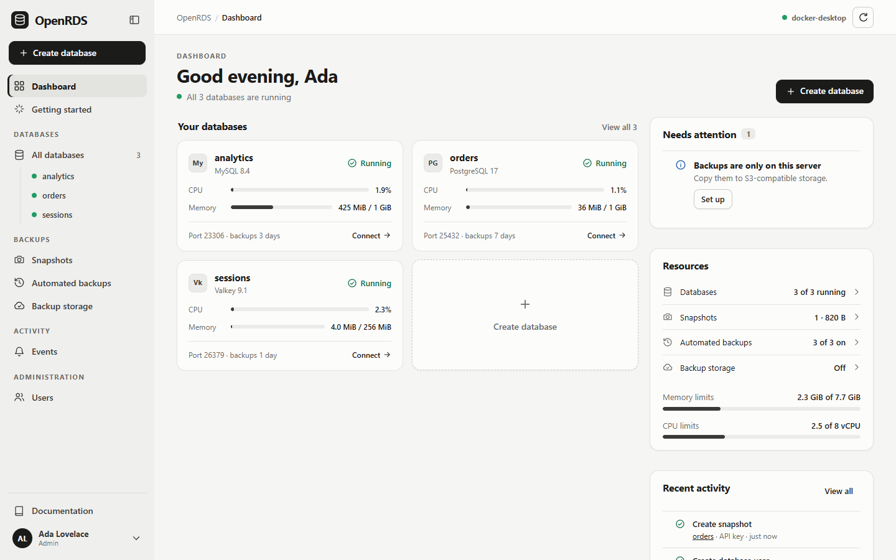
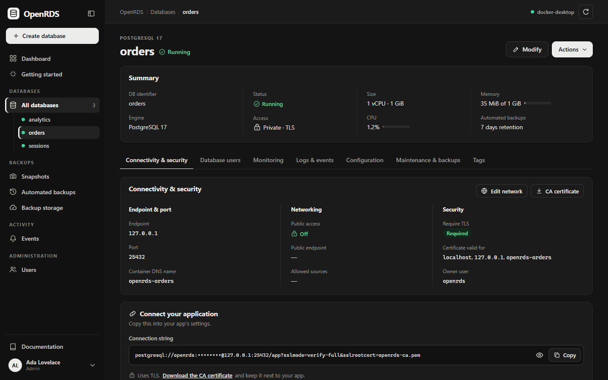
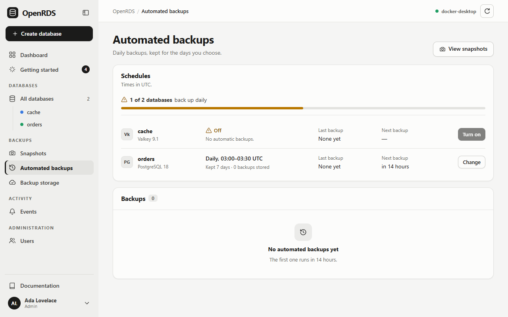
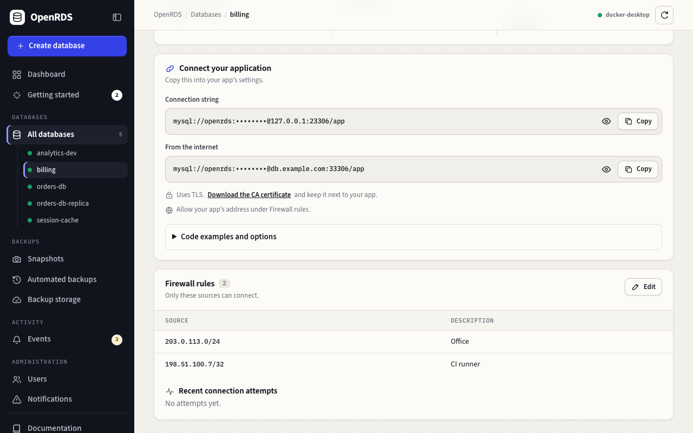
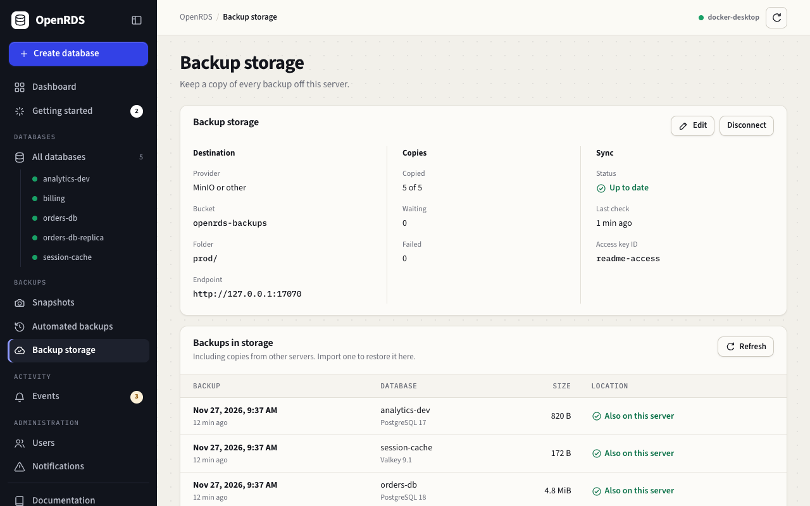
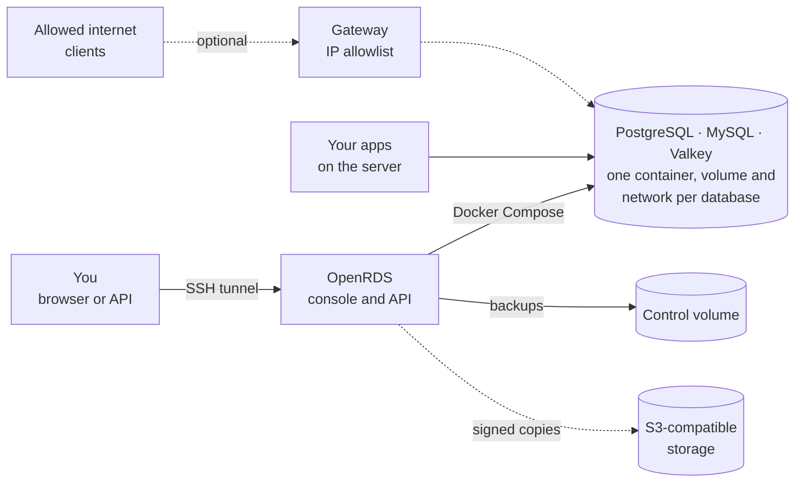

<div align="center">


# OpenRDS

**Self-hosted managed databases for your own server.**

Run PostgreSQL, MySQL and Valkey on one Linux VPS with automated backups, S3 backup copies,<br>
monitoring, TLS and an RDS-style console. No cloud bill.

[](https://github.com/kerjakuyco/openrds/actions/workflows/checks.yaml)
[](LICENSE)
[](go.mod)
[](https://github.com/kerjakuyco/openrds/stargazers)
[](https://github.com/sponsors/kerjakuyco)

[**Install guide**](docs/install.md) · [User guide](docs/guide.md) · [HTTP API](docs/api.md) · [Contributing](CONTRIBUTING.md) · [Report a bug](https://github.com/kerjakuyco/openrds/issues/new?template=bug_report.yml) · [Request a feature](https://github.com/kerjakuyco/openrds/issues/new?template=feature_request.yml)

</div>

<br>



## Why OpenRDS?

Managed database services are convenient but expensive, and running database containers by hand means writing your own backups, users, TLS and monitoring. OpenRDS gives you the managed experience on a server you own: install it with one command, open the console, and create a production-ready database in about a minute.

Each database runs in its own container with its own volume, network and generated password. You manage everything from a console modeled on the AWS RDS console, or from an HTTP API.

## Features

- **Databases in a minute.** PostgreSQL, MySQL and Valkey, from stable to latest versions, with size presets, CPU and memory limits you can change later, optional disk caps, engine parameters and tags. Memory settings such as `shared_buffers` and `innodb_buffer_pool_size` follow each database's memory limit.
- **Backups you can rely on.** Automated backups from daily to hourly with a retention period, manual snapshots, a final snapshot on delete, and restores into a new database. Copies go to any S3-compatible storage (Amazon S3, Cloudflare R2, Backblaze B2, Wasabi, MinIO) and can be imported on a new server after losing the old one.
- **Connection pooling.** PgBouncer in front of PostgreSQL, like RDS Proxy, so hundreds of clients share a few server connections. Turn it on without restarting the database.
- **Secure by default.** Databases listen only on the server itself. Add read-only or read-write database users, change passwords, require TLS with a certificate authority per installation, and open a database to the internet only through an IP allowlist. Every password reveal is recorded.
- **Easy to operate.** Monitoring charts with connections, throughput and cache hit ratio, Performance insights with the top statements and what runs now, logs and events, deletion protection, settings that apply now or at the next restart, and a dashboard that recommends what to fix. Snapshots and restores of large databases finish even if your browser disconnects, and backups never fill the disk your databases need.
- **Made for teams.** Accounts with admin, operator and viewer roles, invitations, password resets and an audit trail.
- **Alerts where you work.** Slack, Discord, Telegram, webhook or email messages when a database turns unhealthy, crashes or runs out of memory, an operation fails, or disk space runs low.
- **Simple to run.** One Go binary and Docker. No external services, no frontend build step.

## Supported engines

| Engine | Versions | Default | Backup format |
| --- | --- | --- | --- |
| **PostgreSQL** | 19 (latest), 18 (stable), 17, 16, 15 | 18 | `pg_dump` custom format |
| **MySQL** | 9.7 LTS (latest), 8.4 LTS (stable) | 8.4 | `mysqldump` with routines, events and triggers |
| **Valkey** (Redis compatible) | 9.2 (latest), 9.1 (stable), 9.0, 8.1, 8.0, 7.2 | 9.1 | RDB snapshot |

A database keeps its version until you upgrade it: **Upgrade** moves it to a newer version in place, keeping its endpoint, credentials and users, with a snapshot taken first. [More about versions](docs/guide.md#engine-versions).

## Screenshots

<table>
  <tr>
    <td width="50%"><p align="center"><b>Database details</b></p></td>
    <td width="50%"><p align="center"><b>Automated backups</b></p></td>
  </tr>
  <tr>
    <td width="50%"><p align="center"><b>Public access and firewall</b></p></td>
    <td width="50%"><p align="center"><b>S3 backup storage</b></p></td>
  </tr>
</table>

## Quick start

You need a Linux server with SSH access. The installer sets up Docker for you if it's missing.

1. **Install.** On the server, run:

   ```sh
   curl -fsSL https://raw.githubusercontent.com/kerjakuyco/openrds/main/install.sh | sh
   ```

2. **Open the console.** On your computer, open the SSH tunnel the installer prints and keep it running:

   ```sh
   ssh -N -L 8080:127.0.0.1:8080 you@your-server
   ```

3. **Create your account.** Visit **http://127.0.0.1:8080** and create the administrator account.
4. **Create a database.** Pick PostgreSQL, MySQL or Valkey. It's ready in about a minute.
5. **Connect.** Copy the connection string from **Connectivity & security** into your app.

**New to servers?** Follow the **[step-by-step install guide with screenshots](docs/install.md)**. It also covers backups to S3, inviting your team, internet access and troubleshooting.

<details>
<summary><b>Installer details and requirements</b></summary>

<br>

The installer downloads OpenRDS into `~/openrds`, offers to install Docker with Docker's official script if it is missing, builds and starts the console, and then prints what to open. It continues with `sudo` when your user cannot use Docker. Running it again, or `sh install.sh` in your copy, updates OpenRDS and keeps your databases, backups and accounts. Set `OPENRDS_YES=1` to accept its questions, or `OPENRDS_DIR` to choose another folder.

OpenRDS needs **Docker Engine 28+** (rootful, with the local `/var/run/docker.sock`) and the **Docker Compose plugin**. Size the server for your engines, data and local backups. To choose another console port or monitoring interval, copy `.env.example` to `.env` and set `OPENRDS_PORT` or `OPENRDS_METRICS_INTERVAL` before installing.

The console and databases listen only on the server itself, so you reach them through an SSH tunnel. Until the first account exists, whoever opens the console can create it, which means someone with SSH access to the server. If you changed the console port, use that port in the tunnel and URL.

**To try it on your own computer**, install Docker Desktop and run `sh install.sh` from a clone, for example in Git Bash on Windows. It opens at http://127.0.0.1:8080 without a tunnel. Data-volume limits need Linux loop devices, so the console may report them as not enforceable there.

</details>

## How it works



- **One control plane.** A single Go binary serves the console and the HTTP API, and drives Docker through the Docker CLI and Compose. Its state (accounts, database metadata, certificates, backups) lives in one Docker volume.
- **Isolated databases.** Every database is its own Compose project, with its own network, data volume and random password. Ports are published on the server's loopback interface only.
- **Opt-in internet access.** A small gateway container forwards connections from allowed addresses only, and logs every attempt.
- **Backups off the server.** Backups are logical dumps stored on the server and, when you connect storage, copied to an S3-compatible bucket with signed requests.

## Documentation

| Guide | What's inside |
| --- | --- |
| [Install guide](docs/install.md) | Set up a VPS step by step, with screenshots: install, first database, backups, team and internet access. |
| [User guide](docs/guide.md) | Databases and versions, access and security, settings, backups and snapshots, accounts and roles, monitoring, where state lives. |
| [HTTP API](docs/api.md) | Authentication, every endpoint, the roles they need, and examples. |
| [Contributing](CONTRIBUTING.md) | Development setup, project layout, tests and pull requests. |
| [Security policy](SECURITY.md) | How to report a vulnerability privately. |

## Roadmap

OpenRDS grows toward the managed-database experience, one release at a time. Ideas we want to build next:

- Point-in-time restore
- Read replicas

Have a different idea? [Request a feature](https://github.com/kerjakuyco/openrds/issues/new?template=feature_request.yml) or upvote an existing one.

## Contributing

Contributions of every size are welcome: bug reports, documentation fixes, clearer wording in the console, and new features. Read the **[contributing guide](CONTRIBUTING.md)** to set up a development copy and run the tests. For a larger change, open an issue first so we can agree on the approach.

Everyone taking part is expected to follow our [Code of Conduct](CODE_OF_CONDUCT.md).

<a href="https://github.com/kerjakuyco/openrds/graphs/contributors">
  
</a>

## Support

- **Questions and bugs:** [open an issue](https://github.com/kerjakuyco/openrds/issues). Include your OpenRDS commit, OS and Docker version.
- **Security problems:** please don't open a public issue. Use **Report a vulnerability** on the [Security tab](https://github.com/kerjakuyco/openrds/security), as described in [SECURITY.md](SECURITY.md).

## Sponsor

OpenRDS is free and open source. If it saves you time or money, please consider [sponsoring the project on GitHub](https://github.com/sponsors/kerjakuyco). Sponsorships pay for the time that goes into new features, fixes and support.

## License

OpenRDS is licensed under the [Apache License 2.0](LICENSE). You can use, modify and distribute it, including for commercial purposes, as long as you keep the license and [notice](NOTICE). Contributions are accepted under the same license.

Copyright © 2026 Fatur Jr and OpenRDS contributors.
