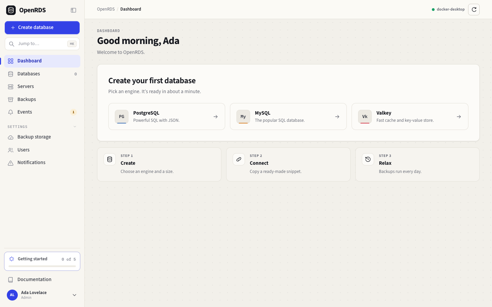
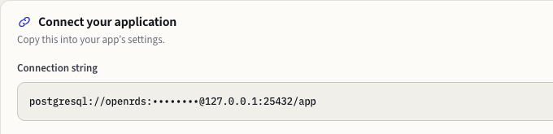
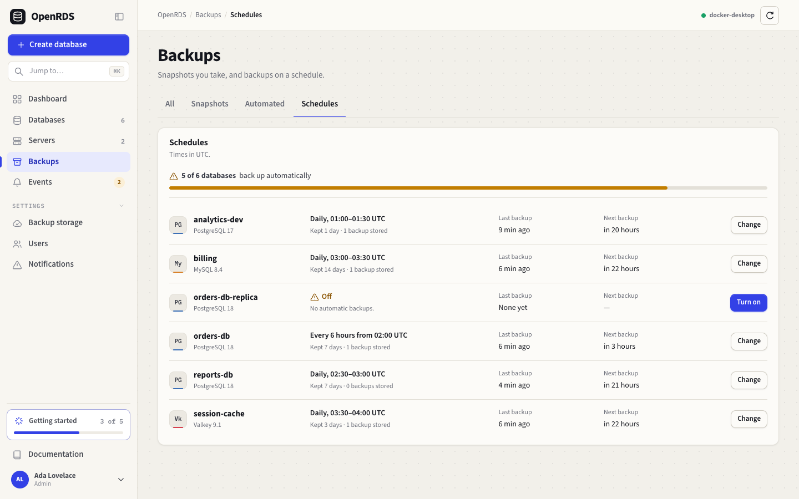
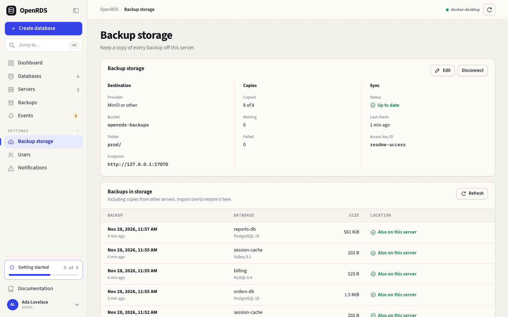
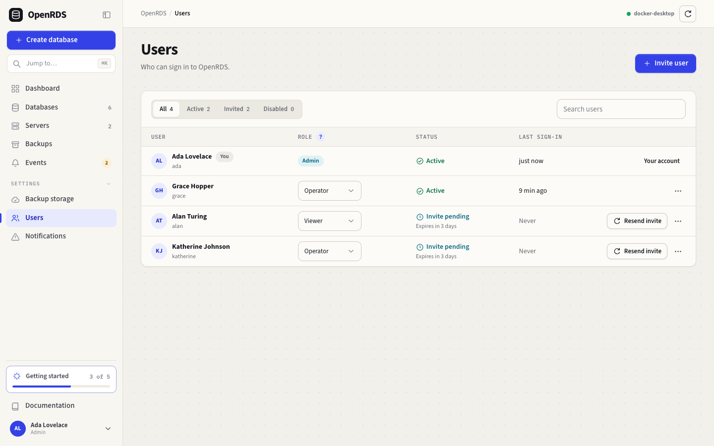
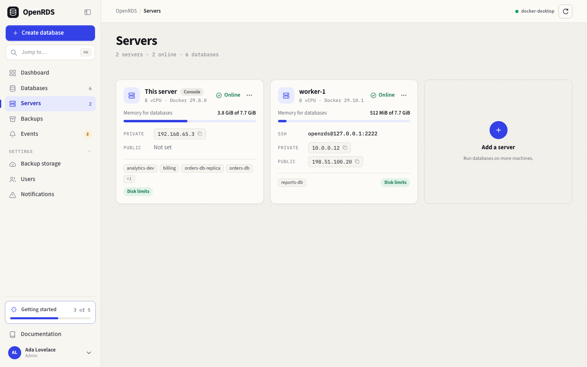

# Install OpenRDS on a Linux VPS

This guide takes you from an empty Linux server to a running database your app can use, with backups, alerts and a team. It takes about 20 minutes, and you don't need to know Docker.

**Contents:** [What you need](#what-you-need) · [1. Prepare the server](#1-prepare-the-server) · [2. Install OpenRDS](#2-install-openrds) · [3. Open the console](#3-open-the-console) · [4. Create your account](#4-create-your-administrator-account) · [5. Create a database](#5-create-your-first-database) · [6. Connect your app](#6-connect-your-application) · [7. Protect your backups](#7-protect-your-backups) · [8. Get alerts](#8-get-alerts) · [9. Invite your team](#9-invite-your-team) · [10. Internet access](#10-optional-allow-connections-from-the-internet) · [11. More servers](#11-optional-add-more-servers) · [Update](#update-openrds) · [Move to a new server](#move-to-a-new-server) · [Uninstall](#uninstall) · [Security checklist](#security-checklist) · [Troubleshooting](#troubleshooting)

## What you need

- **A Linux server (VPS)** from any provider. Ubuntu 24.04 or 22.04 LTS and Debian 12 are tested; any 64-bit Linux (x86-64 or ARM64) that runs Docker Engine 28 or newer works.
- **SSH access** as a user that can use `sudo`, or as `root`.
- **A terminal on your computer** with `ssh`: Terminal on macOS and Linux, or PowerShell or Windows Terminal on Windows.

How big a server? Each database gets the memory you give it, so add them up:

| What you run | Memory | CPU | Disk |
| --- | --- | --- | --- |
| A first try: one or two small databases | 2 GB | 1–2 vCPU | 20 GB |
| A few production databases | 4–8 GB | 2–4 vCPU | 40 GB or more, SSD |
| Each MySQL database | add 1 GB | | |

Backups are full copies, kept on the same disk until they expire, so leave room for them: a 2 GB database backed up daily for 7 days needs up to 14 GB more. [Backup storage](#7-protect-your-backups) keeps copies off the server too.

You don't need to install Docker yourself: the installer offers to do it.

## 1. Prepare the server

These steps take five minutes and make the server safer. On a server you already run, skip what you've done.

**Sign in.** Open a terminal on your computer and connect with the address and user from your provider:

```sh
ssh root@203.0.113.10
```

**Update the system:**

```sh
apt update && apt upgrade -y
```

**Use your own user, not root.** If your provider only gave you `root`, create a user that can use `sudo`, copy your SSH key to it, and sign in again as that user:

```sh
adduser deploy
usermod -aG sudo deploy
rsync --archive --chown=deploy:deploy ~/.ssh /home/deploy
exit
ssh deploy@203.0.113.10
```

**Turn on the firewall, allowing only SSH** (on Debian, install it first with `sudo apt install ufw`):

```sh
sudo ufw allow OpenSSH
sudo ufw enable
```

That's all OpenRDS needs: the console and the databases listen only on the server itself, and you reach them through SSH. If you later open a database to the internet, OpenRDS enforces its own allowlist on that port, because Docker publishes ports ahead of `ufw` (see [step 10](#10-optional-allow-connections-from-the-internet)).

**On a 2 GB server, add swap** so a busy moment doesn't run out of memory:

```sh
sudo fallocate -l 2G /swapfile && sudo chmod 600 /swapfile
sudo mkswap /swapfile && sudo swapon /swapfile
echo '/swapfile none swap sw 0 0' | sudo tee -a /etc/fstab
```

## 2. Install OpenRDS

On the server, run:

```sh
curl -fsSL https://raw.githubusercontent.com/kerjakuyco/openrds/main/install.sh | sh
```

Prefer to read a script before running it? Download it, read it, then run it:

```sh
curl -fsSL https://raw.githubusercontent.com/kerjakuyco/openrds/main/install.sh -o install.sh
less install.sh
sh install.sh
```

The installer:

1. Downloads OpenRDS into `~/openrds`.
2. Offers to install Docker with Docker's official script if it's missing. Answer **Y**.
3. Continues with `sudo` if your user can't use Docker yet. Enter your password if asked.
4. Builds and starts OpenRDS. The first build takes a few minutes.

When it finishes, it prints what to do next:

```text
OpenRDS is running.

  From your computer, open a tunnel and keep it running:
      ssh -N -L 8080:127.0.0.1:8080 deploy@203.0.113.10
  Then open http://127.0.0.1:8080 in your browser.
  (On this server itself, the address is the same.)

Open it now and create your administrator account.
```

OpenRDS starts again by itself after the server restarts, and so do your databases.

## 3. Open the console

The console is private: it only listens on the server itself, so nobody on the internet can reach it. You open it through an **SSH tunnel**, which forwards a port on your computer to the server.

On **your computer**, open a **new** terminal window and run the command the installer printed:

```sh
ssh -N -L 8080:127.0.0.1:8080 deploy@203.0.113.10
```

It shows nothing and keeps running. That's normal; leave the window open while you use OpenRDS. Then open **http://127.0.0.1:8080** in your browser.

**Tip:** save the tunnel in `~/.ssh/config` on your computer, then `ssh -N openrds` opens it:

```text
Host openrds
  HostName 203.0.113.10
  User deploy
  LocalForward 8080 127.0.0.1:8080
```

## 4. Create your administrator account

The first time, OpenRDS asks you to create the administrator account. Choose a username and a strong password. There's no token to find or paste.


Only the first visitor can do this, and only people with SSH access to your server can reach the console. So do it right after installing.

## 5. Create your first database

On a new server, the dashboard asks which engine you want: **PostgreSQL**, **MySQL** or **Valkey** (a Redis-compatible cache).



Pick one and fill in the form:

- **Identifier:** a name such as `orders-db`.
- **Engine version:** the stable version is selected. Pick the latest for the newest features.
- **Template:** **Production** (backups kept 7 days, deletion protection) or **Dev and test** (smaller, backups kept 1 day).
- **Size**, **backups** and other settings are already filled in. You can change any of them later.

Then click **Create database**. It's ready in about a minute; the first one takes longer while Docker downloads the engine.


## 6. Connect your application

Open the database and choose **Connect**: it shows the connection string. Click **Copy**: it copies the full string, password included. Paste it into your app's settings, usually as `DATABASE_URL`.



- **An app on the same server:** use the string as it is.
- **An app or tool on your computer:** open a tunnel to the database's port first, then use the same string. For example, for port 25432:

  ```sh
  ssh -N -L 25432:127.0.0.1:25432 deploy@203.0.113.10
  ```

- **An app on another server:** use a private network ([step 11](#11-optional-add-more-servers)) or open the database to that server's address ([step 10](#10-optional-allow-connections-from-the-internet)).
- **Code examples and options** has snippets for Node.js, Python, Go, Prisma, Django, Laravel, Java and command-line tools.
- **Database users:** to give each app its own login with only the access it needs, create users on the **Users** tab.

## 7. Protect your backups

**Automated backups** run on a schedule, from once a day to every hour, and are kept for the days you choose. The Production template turns them on. Under **Backups → Schedules**, check each database's schedule and use **Turn on** or **Change**.



Backups are stored on the server, so they're lost if the server is. Keep a copy elsewhere with **Settings → Backup storage** in the sidebar:

1. At your storage provider (Amazon S3, Cloudflare R2, Backblaze B2, Wasabi or MinIO), create a **private bucket**, and an **access key** that can read, write, list and delete in it.
2. In OpenRDS, pick the provider. The endpoint and region are filled in for you; adjust them to your bucket.
3. Enter the bucket and the keys, then click **Test connection** and **Save and start copying**.



From then on, every backup is copied to the bucket. If you ever lose the server, see [Move to a new server](#move-to-a-new-server).

**Want to restore to any second?** Turn on **Point-in-time recovery** on a PostgreSQL or MySQL database's **Settings** tab.

## 8. Get alerts

Under **Settings → Notifications**, add a channel: Slack, Discord, Telegram, a webhook or email. OpenRDS sends a test message first, then tells you when a database becomes unhealthy, crashes or runs out of memory, an operation such as a backup fails, or disk space runs low.

## 9. Invite your team

Under **Settings → Users**, click **Invite user**, choose a role and send the link the console shows. The link works once, for 72 hours.

- **Admin:** everything, including accounts.
- **Operator:** manage databases, backups and access.
- **Viewer:** look only.



Teammates open the link through their own SSH tunnel, like in [step 3](#3-open-the-console). Give each of them their own SSH user on the server.

## 10. (Optional) Allow connections from the internet

By default, databases can't be reached from outside the server. If an app runs elsewhere, for example on a hosting platform, you can open one database to specific addresses:

1. First turn on **Require TLS** on the database's **Settings** tab, so traffic is encrypted.
2. On the **Connect** tab, under **Connectivity & security**, click **Edit network**, turn on **Public access**, choose a port, and add the IP addresses allowed to connect.
3. If your provider has its own firewall, for example a cloud firewall or security group, allow that port there too. You don't need a `ufw` rule.


Only the addresses you list can connect; everything else is refused, and **Recent connection attempts** shows who tried. Docker bypasses host firewalls like `ufw`, which is why OpenRDS enforces the list itself.

## 11. (Optional) Add more servers

OpenRDS can run databases on other servers too, all managed from this console over SSH. On the **Servers** page, click **Add a server** and follow the three steps:

1. **Prepare.** On the new server, install Docker Engine 28 or newer (`curl -fsSL https://get.docker.com | sudo sh`), then run the command the dialog shows. It creates an `openrds` user that accepts the console's SSH key.
2. **Connect.** Enter a name and the SSH address, such as `openrds@10.0.0.5`.
3. **Verify.** Compare the fingerprint with the one `ssh-keygen -lf /etc/ssh/ssh_host_ed25519_key.pub` prints on the server, and tick **They match**.



The new server only needs SSH open to the console's server. OpenRDS finds the servers' private and public addresses itself.

- **Choose where a database runs** when you create it.
- **Move a database** with **Move** next to its server. Writes pause for a few seconds, and everything else comes along: name, users, settings and backups.
- **Reach databases from your other servers** over a private network (your provider's VPC, WireGuard or Tailscale): turn on **Private access** under **Connect → Edit network**. Allow the database's port between the servers in your provider's firewall.
- **Keep a copy on another server** with a read replica, and promote it if a server is lost.

## Update OpenRDS

Run the install command again:

```sh
curl -fsSL https://raw.githubusercontent.com/kerjakuyco/openrds/main/install.sh | sh
```

It downloads the newest version into `~/openrds`, rebuilds the console and keeps your databases, backups and accounts. Databases keep running during the update; only the console restarts. To update a copy you cloned yourself, run `git pull` and then `sh install.sh` in it.

## Move to a new server

- **Databases, with seconds of downtime:** on the new server, install Docker, add it under **Servers**, and **Move** each database to it. The console stays where it is.
- **After losing a server:** install OpenRDS on a new one, connect the same bucket under **Settings → Backup storage**, open **Backups in storage**, **Import** a backup and restore it. With point-in-time recovery, restore it to a time: the logs come from the bucket too.

## Uninstall

Delete your databases in the console first: each one runs on its own, so removing the console leaves them running. Then, in `~/openrds` (with `sudo` if your user isn't in the `docker` group):

```sh
docker compose down -v
```

**This deletes the console's data for good**, including the backups stored on the server and the keys for other servers. Copies in your bucket stay.

## Security checklist

- Sign in with SSH keys and turn off password sign-in (`PasswordAuthentication no` in `/etc/ssh/sshd_config`).
- Keep only SSH open in `ufw` and your provider's firewall.
- Turn on automatic security updates: `sudo apt install unattended-upgrades`.
- Give each person their own OpenRDS account and SSH user, with the smallest role that works.
- Require TLS before opening a database to the internet, and allow only the addresses that need it.
- Connect backup storage, and try restoring a backup now and then.
- Anyone in the server's `docker` group can control every database: treat it like root.

## Troubleshooting

**The browser can't open http://127.0.0.1:8080.** Make sure the tunnel from step 3 is still running, and that you used the same port in the tunnel and the address.

**Port 8080 is already used on my computer.** Tunnel through another local port and open that instead:

```sh
ssh -N -L 9090:127.0.0.1:8080 deploy@203.0.113.10
```

Then open http://127.0.0.1:9090.

**"permission denied" when I run `docker` myself.** Your user isn't in the `docker` group, which is fine: OpenRDS doesn't need it. Use `sudo docker …`, or add yourself with `sudo usermod -aG docker $USER` and sign in again.

**I forgot the administrator password.** On the server, run this and open the link it prints, through your tunnel:

```sh
cd ~/openrds && sudo docker compose exec openrds openrds reset-password YOUR_USERNAME
```

**I want the console on another port, or more frequent monitoring.** On the server, copy `.env.example` to `.env` in `~/openrds`, set `OPENRDS_PORT` or `OPENRDS_METRICS_INTERVAL`, and run `sh install.sh` there.

**A database won't start, or keeps restarting.** Check its **Logs** tab and **Events**. "Out of memory" means it needs a higher memory limit: change it under **Settings → Instance size**. A port in use by another program needs another port.

**Disk space is running low.** Backups stop before they fill the disk, so your databases keep running. Delete old snapshots, shorten retention, or grow the disk; connect backup storage to keep copies elsewhere.

**The disk limit says "not enforceable here".** Disk limits need rootful Docker on Linux. Leave the field empty for a regular volume.

**Something else went wrong.** Check the console's **Events** page, the database's **Logs** tab, or the console's own log:

```sh
cd ~/openrds && sudo docker compose logs --tail 100 openrds
```

If you're stuck, [open an issue](https://github.com/kerjakuyco/openrds/issues) with your OpenRDS version (`git -C ~/openrds log -1 --oneline`), your Linux and Docker versions, and what you saw.

For every feature in detail, read the [user guide](guide.md).
