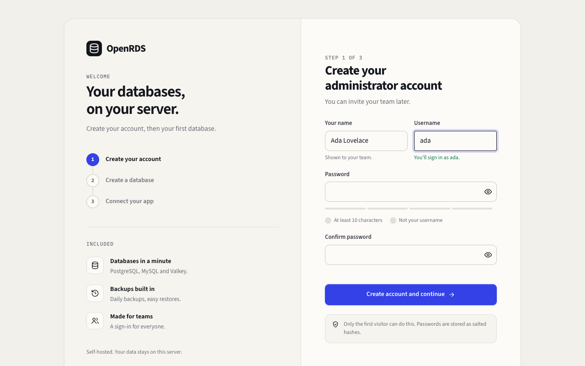
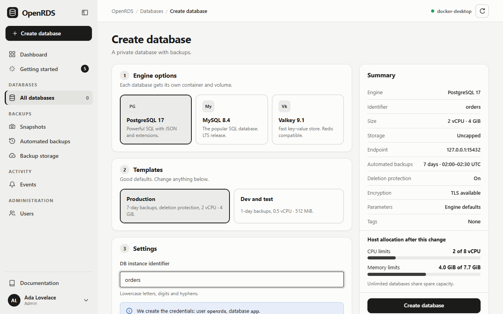
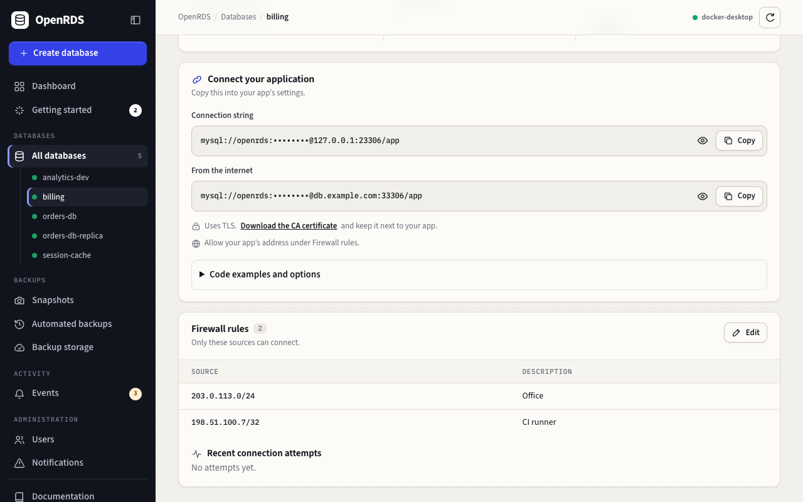

# Install and set up OpenRDS on a VPS

This guide takes you from an empty server to a running database your app can use, with backups and a team. It takes about 15 minutes, and you don't need to know Docker.

**Contents:** [What you need](#what-you-need) · [1. Connect to your server](#1-connect-to-your-server) · [2. Install OpenRDS](#2-install-openrds) · [3. Open the console](#3-open-the-console) · [4. Create your account](#4-create-your-administrator-account) · [5. Create a database](#5-create-your-first-database) · [6. Connect your app](#6-connect-your-application) · [7. Protect your backups](#7-protect-your-backups) · [8. Invite your team](#8-invite-your-team) · [9. Internet access (optional)](#9-optional-allow-connections-from-the-internet) · [Updating](#keep-openrds-up-to-date) · [Troubleshooting](#troubleshooting)

## What you need

- **A Linux server (VPS)** from any provider, for example Ubuntu 22.04 or 24.04, or Debian 12.
  - At least **2 GB of memory**; **4 GB or more** if you run MySQL or several databases.
  - Enough disk for your data plus local backups.
- **SSH access** to the server, as a user that can use `sudo`.
- **A terminal on your computer** with `ssh`: Terminal on macOS and Linux, or PowerShell or Windows Terminal on Windows.

You don't need to install Docker yourself: the installer offers to do it.

## 1. Connect to your server

Open a terminal on your computer and sign in to the server. Use the address and user from your provider:

```sh
ssh you@203.0.113.10
```

## 2. Install OpenRDS

On the server, run:

```sh
curl -fsSL https://raw.githubusercontent.com/kerjakuyco/openrds/main/install.sh | sh
```

The installer:

1. Downloads OpenRDS into `~/openrds`.
2. Offers to install Docker if it's missing. Answer **Y**.
3. Builds and starts OpenRDS. The first build takes a few minutes.

When it finishes, it prints what to do next:

```text
OpenRDS is running.

  From your computer, open a tunnel and keep it running:
      ssh -N -L 8080:127.0.0.1:8080 you@203.0.113.10
  Then open http://127.0.0.1:8080 in your browser.
  (On this server itself, the address is the same.)

Open it now and create your administrator account.
```

## 3. Open the console

The console is private: it only listens on the server itself, so nobody on the internet can reach it. You open it through an **SSH tunnel**, which forwards a port on your computer to the server.

On **your computer**, open a **new** terminal window and run the command the installer printed:

```sh
ssh -N -L 8080:127.0.0.1:8080 you@203.0.113.10
```

It shows nothing and keeps running. That's normal; leave the window open while you use OpenRDS. Then open **http://127.0.0.1:8080** in your browser.

## 4. Create your administrator account

The first time, OpenRDS asks you to create the administrator account. Choose a username and a strong password. There's no token to find or paste.



Only the first visitor can do this, and only people with SSH access to your server can reach the console. So do it right after installing.

## 5. Create your first database

On a new server, the dashboard asks which engine you want: **PostgreSQL**, **MySQL** or **Valkey** (a Redis-compatible cache).


Pick one and fill in the form:

- **Identifier:** a name such as `orders`.
- **Engine version:** the stable version is selected. Pick the latest for the newest features.
- **Template:** **Production** (daily backups kept 7 days, deletion protection) or **Dev and test** (smaller, 1-day backups).
- **Size**, **backups** and other settings are already filled in. You can change any of them later.

Then click **Create database**. It's ready in about a minute; the first one takes longer while Docker downloads the engine.



## 6. Connect your application

Open the database and choose **Connect**: the **Connect** tab shows its connection string. Click **Copy**: it copies the full string, password included. Paste it into your app's settings, usually as `DATABASE_URL`.


- **An app on the same server:** use the string as it is.
- **An app or tool on your computer:** open a tunnel to the database's port first, then use the same string. For example, for port 25432:

  ```sh
  ssh -N -L 25432:127.0.0.1:25432 you@203.0.113.10
  ```

- **Code examples and options** has snippets for Node.js, Python, Go, Prisma, Django, Laravel, Java and command-line tools.
- **Database users:** to give each app its own login with only the access it needs, create users on the **Users** tab.

## 7. Protect your backups

**Automated backups** run every day and are kept for the days you choose. The Production template turns them on. Under **Backups → Automated backups**, you can check each database's schedule and use **Turn on** or **Change**.


Backups are stored on the server, so they're lost if the server is. Keep a copy elsewhere with **Backups → Backup storage**:

1. At your storage provider (Amazon S3, Cloudflare R2, Backblaze B2, Wasabi or MinIO), create a **private bucket**, and an **access key** that can read, write, list and delete in it.
2. In OpenRDS, pick the provider. The endpoint and region are filled in for you; adjust them to your bucket.
3. Enter the bucket and the keys, then click **Test connection** and **Save and start copying**.


From then on, every backup is copied to the bucket. If you ever lose the server, install OpenRDS on a new one, connect the same bucket, and **Import** a backup from **Backups in storage** to restore it.

## 8. Invite your team

Under **Administration → Users**, click **Invite user**, choose a role and send the link the console shows. The link works once, for 72 hours.

- **Admin:** everything, including accounts.
- **Operator:** manage databases, backups and access.
- **Viewer:** look only.


Teammates open the link through their own SSH tunnel, like in step 3.

## 9. (Optional) Allow connections from the internet

By default, databases can't be reached from outside the server. If an app runs elsewhere, for example on a hosting platform, you can open one database to specific addresses:

1. First turn on **Require TLS** on the database's **Settings** tab, so traffic is encrypted.
2. On the **Connect** tab, under **Connectivity & security**, click **Edit network**, turn on **Public access**, choose a port, and add the IP addresses allowed to connect.
3. If your provider has its own firewall, for example a cloud firewall or security group, allow that port there too.



Only the addresses you list can connect; everything else is refused. Docker bypasses host firewalls like `ufw`, which is why OpenRDS enforces the list itself.

## 10. (Optional) Add more servers

OpenRDS can run databases on other servers too, managed from this console over SSH. On the **Servers** page, click **Add server** and follow the dialog:

1. On the new server, install Docker Engine 28 or newer, then run the command the dialog shows. It creates an `openrds` user that accepts the console's SSH key.
2. Enter a name and the SSH address, such as `openrds@10.0.0.5`. Click **Check host key**, and compare the fingerprint with the one `ssh-keygen -lf /etc/ssh/ssh_host_ed25519_key.pub` prints on the server.
3. If your servers share a private network, enter the new server's private address, so apps on your other servers can reach its databases privately.

When you create a database, choose which server it runs on.

## Keep OpenRDS up to date

Run the install command again, or on the server:

```sh
cd ~/openrds && sh install.sh
```

Your databases, backups and accounts are kept.

## Troubleshooting

**The browser can't open http://127.0.0.1:8080.** Make sure the tunnel from step 3 is still running, and that you used the same port in the tunnel and the address.

**Port 8080 is already used on my computer.** Tunnel through another local port and open that instead:

```sh
ssh -N -L 9090:127.0.0.1:8080 you@203.0.113.10
```

Then open http://127.0.0.1:9090.

**I forgot the administrator password.** On the server, run this and open the link it prints, through your tunnel:

```sh
cd ~/openrds && docker compose exec openrds openrds reset-password YOUR_USERNAME
```

**I want the console on another port, or more frequent monitoring.** On the server, copy `.env.example` to `.env`, set `OPENRDS_PORT` or `OPENRDS_METRICS_INTERVAL`, and run `sh install.sh` again.

**The disk limit says "not enforceable here".** Disk limits need rootful Docker on Linux. Leave the field empty for a regular volume.

**Something else went wrong.** Check the console's **Events** page, the database's **Logs** tab, or the server's log:

```sh
cd ~/openrds && docker compose logs --tail 100 openrds
```

If you're stuck, [open an issue](https://github.com/kerjakuyco/openrds/issues).

For every feature in detail, read the [user guide](guide.md).
